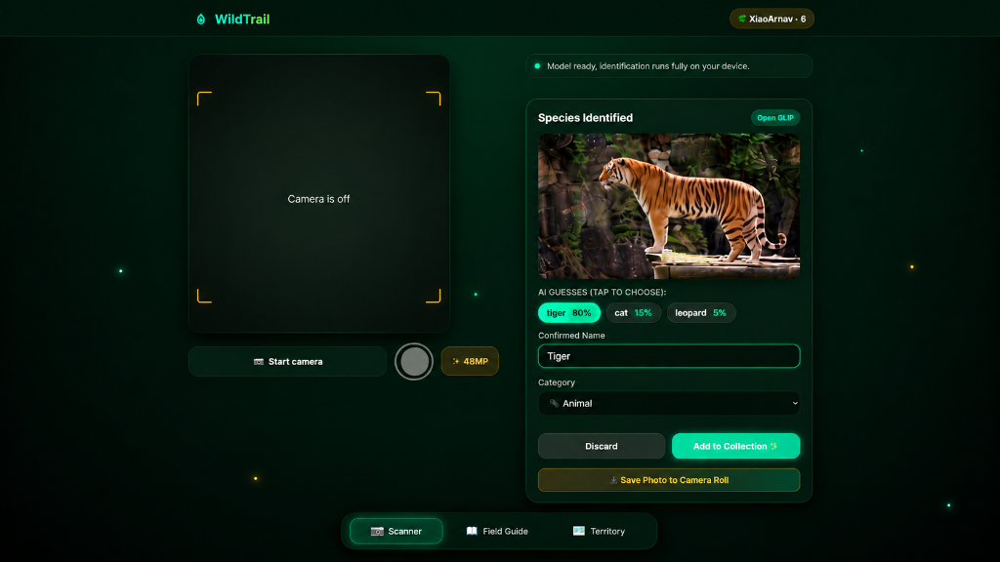
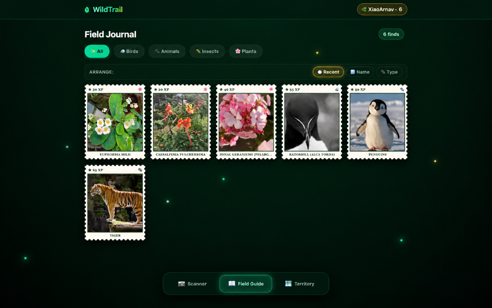
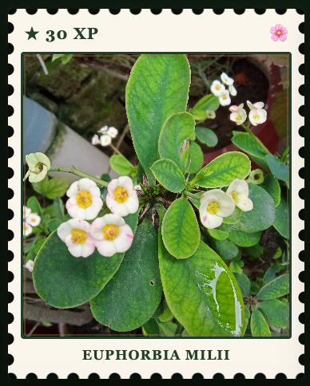
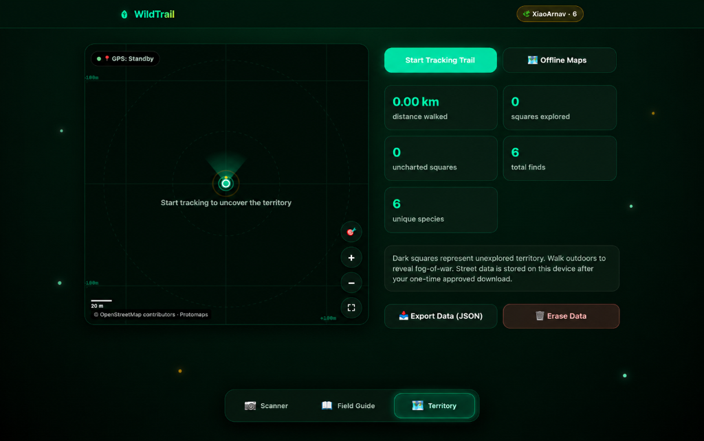
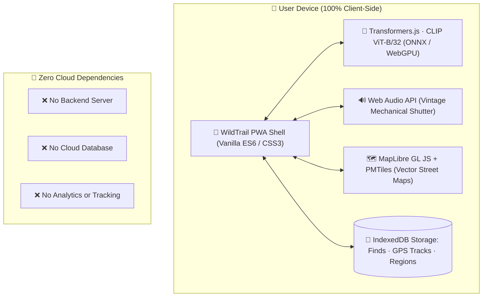

<div align="center">

# 🌿 WildTrail

### Step outside. Discover more. Keep every wild encounter.

**A privacy-first nature exploration PWA that turns the outdoors into your personal field journal.**

[](https://wildtrail-chi.vercel.app)
[](https://hacktoberfest.com)
[](LICENSE)
[](#install-as-a-progressive-web-app)

<br />

*Your pocket-sized field station — built for curious minds, muddy trails, and the little things worth noticing.*

</div>

---

## 🧭 The wild is closer than you think.

WildTrail combines real-time species discovery, a collectible botanical journal, and GPS-powered adventure mapping into one private, local-first web application. Identify wildlife outdoors, mint vintage specimen stamps, and gradually uncover the fog-of-war across your neighborhood.


<div align="center">

| 📷 **Discover** | 📚 **Collect** | 🗺️ **Explore** |
|:---:|:---:|:---:|
| Identify species in milliseconds with on-device computer vision AI. | Transform outdoor finds into tactile, vintage-inspired specimen stamps. | Track your hiking trail and uncover real-world map territory as you move. |

</div>

---

## 📸 A Closer Look

### 01 · Scanner — Identify what catches your eye

Point your camera, capture a specimen, and review suggested identifications with instant confidence scoring. The neural network runs entirely inside your browser's WebAssembly/WebGPU runtime, ensuring zero latency and total location privacy.

<div align="center">
  
  <p><sub>Review suggested species classifications, verify taxonomy, and save uncropped high-resolution photos directly to your collection.</sub></p>
</div>

---

### 02 · Field Guide — Make every find memorable

Every confirmed encounter is minted into a tactile, postage-stamp-inspired keepsake. Browse your collection across kingdom categories (Animals, Birds, Plants, Insects), arrange finds by recency or name, and flip cards to inspect handwritten botanical notes.

<div align="center">
  
  <p><sub>Your interactive specimen archive featuring 3D tilt physics, perforation scalloping, and explorer XP points.</sub></p>
</div>

<br />

#### 🏷️ Collectible Specimen Stamps Gallery

<div align="center">
  <table>
    <tr>
      <td align="center" width="25%">
        
        <br />
        <b>🐅 Animals</b>
        <br />
        <sub><i>Panthera tigris</i> · 65 XP</sub>
      </td>
      <td align="center" width="25%">
        
        <br />
        <b>🐧 Birds</b>
        <br />
        <sub><i>Alca torda</i> · 55 XP</sub>
      </td>
      <td align="center" width="25%">
        
        <br />
        <b>❄️ Polar Fauna</b>
        <br />
        <sub><i>Spheniscidae</i> · 50 XP</sub>
      </td>
      <td align="center" width="25%">
        
        <br />
        <b>🌸 Plants</b>
        <br />
        <sub><i>Euphorbia milii</i> · 30 XP</sub>
      </td>
    </tr>
  </table>
</div>

---

### 03 · Territory — Turn a walk into an expedition

Experience outdoor walks like an adventure RPG. Fog-of-war tiles conceal unexplored wilderness until you physically traverse them. Real-time GPS pathfinding paints glowing trail coordinates, charts total distance walked, and plots interactive specimen discovery pins.

<div align="center">
  
  <p><sub>Dynamic fog-of-war, heading compass, radar pulse ripples, and offline PMTiles vector mapping.</sub></p>
</div>

---

## 🔒 Local-First Privacy Architecture

WildTrail is engineered around an uncompromising **zero-telemetry, client-side only** architecture:



<details open>
<summary><b>🔐 Privacy & Storage Guarantees</b></summary>

* **No Accounts or Logins:** Start exploring immediately without entering an email, password, or third-party OAuth.
* **On-Device Inference:** Vision inference runs locally inside browser memory. Photos are never uploaded to remote cloud APIs.
* **100% Private Coordinates:** GPS location is processed purely on-device to reveal local fog-of-war.
* **Complete Data Ownership:** Export your entire journal and trail history as a single JSON file, or wipe local storage with one click.

</details>

---

## 🛠️ Feature Breakdown

<details open>
<summary><b>📷 On-Device Species Scanner</b></summary>

- **In-Browser Vision AI:** Powered by OpenAI CLIP (`clip-vit-base-patch32`) optimized for Transformers.js.
- **Hardware Lens Switching:** Real physical front/back camera lens switching via `MediaDevices.enumerateDevices` (no mirrored CSS flips).
- **Exact Framing Parity:** Live viewfinder and saved photo match 1:1 without unintended cropping.
- **Mechanical Shutter Audio:** Emits a realistic 35mm mechanical SLR shutter sound with dual body resonance on capture.
- **Save to Camera Roll:** Direct export to your device's photo gallery with metadata tags.

</details>

<details open>
<summary><b>📖 Collectible Field Journal</b></summary>

- **Perforated 3D Postage Stamps:** Rendered with realistic scalloped teeth, soft drop shadows, and multi-axis tilt physics.
- **180° Card Flip:** Inspect handwritten botanical notes, taxonomy details, collection timestamps, and regional coordinates.
- **Category Taxonomy:** Organize finds across Birds, Animals, Insects, and Plants.
- **Multi-Mode Sorting:** Filter and sort your findings by recency, species name, or classification type.

</details>

<details open>
<summary><b>🗺️ GPS Territory Exploration</b></summary>

- **Dynamic Fog-of-War:** Dark hexagonal grid uncovers real-world terrain as you walk outdoors.
- **Navigation HUD:** Dynamic vision cone indicating heading, glowing GPS trail, and dynamic scale ruler.
- **Discovery Pins:** Tap any discovery pin to open specimen details and jump directly to its Field Guide card.
- **Offline PMTiles Maps:** Download vector street boundaries (~12–18 MB) for offline wilderness expeditions.

</details>

---

## 🏗️ Built With

| Layer | Technology | Purpose |
|:---|:---|:---|
| **Interface** | HTML5, CSS Variables, Vanilla ES6+ | Zero bundler bloat, ultra-lightweight performance |
| **Vision AI** | [Transformers.js](https://huggingface.co/docs/transformers.js) · CLIP `clip-vit-base-patch32` | 100% on-device neural image classification |
| **Interactive Maps** | [MapLibre GL JS](https://maplibre.org/) | GPU-accelerated vector map rendering |
| **Offline Mapping** | [PMTiles](https://protomaps.com/) · Protomaps | Single-file vector tile archives stored in browser |
| **Local Persistence** | IndexedDB | Private storage for finds, coordinates, and offline regions |
| **Audio Engine** | Web Audio API + HTML5 Audio | Dual PCM synthesis for vintage shutter sound |
| **Installable App** | Service Worker (`wildtrail-v37`) · Web App Manifest | Full offline caching and standalone PWA support |
| **Hosting & Edge** | [Vercel](https://vercel.com/) | Continuous deployment with zero server maintenance |

---

## 🚀 Try WildTrail

### Use the Live App

👉 **[Open WildTrail →](https://wildtrail-chi.vercel.app)**

For the optimal experience, open the link in your mobile browser and add it to your Home Screen.

---

### Run Locally

Camera and geolocation APIs require a secure origin (`HTTPS` or `localhost`):

```bash
# Clone the repository
git clone https://github.com/XiaoArnav/wildtrail.git
cd wildtrail

# Start a local static server using Python 3
python3 -m http.server 8000
```

Then visit **`http://localhost:8000`** in your browser.

---

### Install as a Progressive Web App

* **iPhone / iPad:** Open the site in Safari → tap **Share** (box with arrow) → tap **"Add to Home Screen"**.
* **Android:** Open the site in Chrome → tap **Menu (⋮)** → tap **"Install app"** or **"Add to Home screen"**.
* **Desktop:** Click the install icon in the URL bar (Chrome / Edge / Brave).

> **Offline Wilderness Tip:** Open WildTrail once while connected to Wi-Fi so the vision model weights (~90 MB) and vector map runtime can cache. Once cached, the entire app functions offline in the wilderness!

---

## 🎨 Design Principles

* **Nature First:** Dark botanical emerald palette (`#070e0a`, `#10b981`) illuminated with sunlit amber accents (`#f59e0b`) and bioluminescent spores.
* **Useful Over Noisy:** Clean, distraction-free UI designed to keep you looking up at the trees rather than staring down at notifications.
* **Private by Design:** Observations, locations, and photos remain solely in your device's browser sandbox.
* **Built for the Mud:** PWA caching and offline preparation ensure reliable performance beyond cellular coverage.

---

## 🗺️ Roadmap

- [ ] Extended species taxonomy catalogue and identification guides.
- [ ] Richer field notes, weather telemetry, and observation journals.
- [ ] Multi-region offline map package selector.
- [ ] High-contrast accessibility modes and low-power outdoor tracking.
- [ ] GPX and KML export formats for trail enthusiasts.

---

## 🤝 Contributing & Hacktoberfest 2026

Contributions, bug reports, and pull requests are warmly welcomed! WildTrail is an active open-source project participating in **Hacktoberfest 2026**.

1. Fork the repository.
2. Create a feature branch: `git checkout -b feat/your-improvement`
3. Test your changes thoroughly across desktop and mobile browsers.
4. Submit a clear pull request with descriptions and UI screenshots.

> **Hacktoberfest Quality Standards:** In alignment with official Hacktoberfest rules, contributions must add genuine value (e.g. bug fixes, new species classifications, accessibility improvements, or offline optimizations). Automated copy-paste PRs or trivial whitespace edits will not be accepted.

---

## 📜 Credits & Open Source Attribution

WildTrail is built on open-source projects and public geographic data:

* [Transformers.js](https://huggingface.co/docs/transformers.js) by Xenova / Hugging Face
* [MapLibre GL JS](https://maplibre.org/)
* [PMTiles](https://github.com/protomaps/PMTiles) by Protomaps
* Map vector data © [OpenStreetMap contributors](https://www.openstreetmap.org/copyright)

---

## ⚖️ License

Distributed under the [MIT License](LICENSE). © 2026 Arnav Patel.

---

<div align="center">

**Made for the curious. Inspired by the wild.** 🌱

[Explore WildTrail](https://wildtrail-chi.vercel.app) · [View Source Code](https://github.com/XiaoArnav/wildtrail)

</div>
