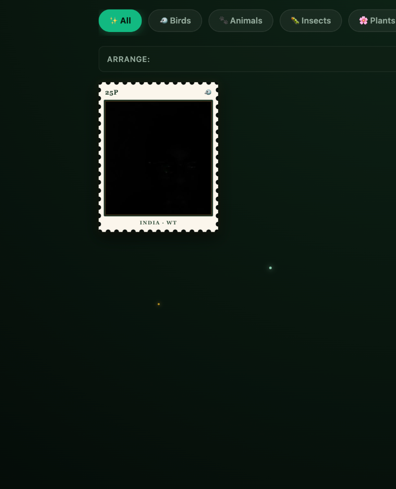
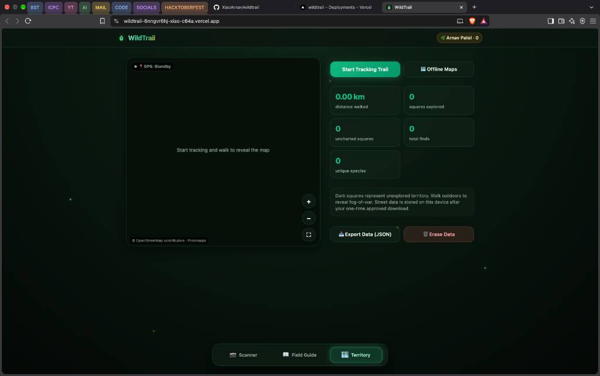

# 🌿 WildTrail

> **Touch grass and collect real wildlife outdoors.**  
> An open-source, 100% private Progressive Web App powered by on-device computer vision AI and offline vector world maps.

[](https://wildtrail-chi.vercel.app)
[](https://hacktoberfest.com)
[](LICENSE)
[](#privacy-by-design)
[](#offline-architecture)

---

## 🧭 Live Deployments

* **Production URL:** [https://wildtrail-chi.vercel.app](https://wildtrail-chi.vercel.app)
* **Alternative Mirror:** [https://wildtrail-xiao-c64a.vercel.app](https://wildtrail-xiao-c64a.vercel.app)
* **Repository:** [https://github.com/XiaoArnav/wildtrail](https://github.com/XiaoArnav/wildtrail)

---

## 📸 Visual Showcase

<div align="center">
  <table>
    <tr>
      <td width="33%" align="center">
        <b>📷 Scanner & Live Viewfinder</b><br><br>
        
      </td>
      <td width="33%" align="center">
        <b>📖 Field Guide & 3D Stamp</b><br><br>
        
      </td>
      <td width="33%" align="center">
        <b>🗺️ Territory & Adventure Map</b><br><br>
        
      </td>
    </tr>
  </table>
</div>

---

## ✨ Key Features

### 1. 📷 Pro Hardware Camera & Zero-Cloud AI Scanner
* **100% On-Device CLIP Vision Inference:** Powered by `Xenova/clip-vit-base-patch32` running via **Transformers.js** inside WebAssembly / WebGPU directly on your phone. No cloud API calls, zero latency, and zero data leaves your handset.
* **Authentic 35mm Mechanical Audio:** Emits a high-fidelity mechanical SLR shutter sound (*Ka-chunk!*) with dual body resonance and focal curtain transit on capture.
* **Hardware Lens Switching:** Real physical camera switching between wide-angle back lens and front selfie camera via `navigator.mediaDevices.enumerateDevices` (no mirrored CSS transformations).
* **Precise Framing Parity:** Camera viewfinder and captured photographs maintain 100% uncropped aspect ratio fidelity.
* **Fluid Mobile Controls:** Multi-touch pinch-to-zoom, desktop mouse-wheel zoom, tap-to-focus with autofocus constraint capability probing, and sensor exposure handling.
* **Save to Camera Roll:** Direct export to native photo roll or auto-download.

### 2. 📖 Field Guide & 3D Archival Postcards
* **Interactive 3D Postage Stamps:** Captured specimens are transformed into vintage postage stamps with scalloped perforation teeth, dynamic holographic sheen, and multi-axis finger/mouse tilt physics.
* **180° Card Flip:** Tap or drag any stamp to flip it around and inspect handwritten botanical archival notes, collection timestamps, GPS regional stamps, and Explorer XP points.
* **Vintage Field Postcard Generator:** Canvas-rendered vintage parchment postcard with ornate double borders, corner flourishes, specimen photo mounts, and seal marks.
* **Native Share Sheet Integration:** One-tap export to iOS/Android native share sheets or high-resolution PNG download.
* **Categorization & Sorting:** Instant filter tabs (Birds, Animals, Insects, Plants) and sorting pills (Recent, Name, Type).

### 3. 🗺️ Territory & RPG Adventure World Map
* **Dynamic Fog-of-War:** Dark hexagonal tiles veil unexplored wilderness. As you walk outside, your GPS path reveals real-world terrain and uncovers territory.
* **Interactive Discovery Pins:** Tapping map pins opens specimen popups with instant jump-to-guide actions.
* **Cartographic Navigation HUD:** Dynamic vision cone showing player heading, glowing dual-stroke GPS trail, radar pulse beacons, cartographic coordinate grid, and dynamic scale ruler.
* **Offline Vector Street Data:** Powered by **MapLibre GL JS** and **PMTiles (Protomaps)**. Allows 1-click, permission-approved offline vector street downloads (~12–18 MB) stored safely inside IndexedDB.
* **Uncharted Exploration Tracker:** Real-time distance walked telemetry, squares explored counter, and edge-warning banners when stepping into uncharted terrain.

---

## 🔒 Privacy by Design

WildTrail is engineered strictly around a **zero-telemetry, local-first** philosophy:
* ❌ **No user accounts or logins.**
* ❌ **No remote database or analytics servers.**
* ❌ **No photos, coordinates, or tracks leave your device.**
* ✅ **100% Local Storage:** All photos, specimens, GPS tracks, and explorer metadata are stored exclusively inside your browser's private **IndexedDB** storage.
* ✅ **You Own Your Data:** Complete 1-click JSON data export and instant permanent erase controls are always accessible in the Territory settings.

---

## 🛠️ Architecture & Tech Stack

| Layer | Technologies |
| :--- | :--- |
| **Frontend Framework** | Vanilla ES6+ Modules, HTML5, Modern CSS Variables (Zero bundler bloat) |
| **Vision AI Engine** | [Transformers.js](https://huggingface.co/docs/transformers.js) · Open CLIP `clip-vit-base-patch32` |
| **Mapping & GIS** | [MapLibre GL JS](https://maplibre.org/) · [PMTiles](https://protomaps.com/) · OpenStreetMap contributors |
| **Audio Engine** | Web Audio API · Dual PCM WAV synthesis · HTML5 Audio Engine |
| **Storage Engine** | IndexedDB (`finds`, `track`, `meta`, `regions`) |
| **Offline PWA** | Service Worker Cache API (`wildtrail-v37`) · Web App Manifest |
| **Hosting & CI/CD** | Vercel Serverless Edge Platform |

---

## 🚀 Getting Started

### Quick Start (Local Development)

Because camera APIs and geolocation require a secure origin (`HTTPS` or `localhost`), run a local web server:

```bash
# Clone the repository
git clone https://github.com/XiaoArnav/wildtrail.git
cd wildtrail

# Start a local server (Python 3)
python3 -m http.server 8000
```

Open `http://localhost:8000` in your browser.

---

### Installing as a Mobile App (PWA)

WildTrail is fully PWA-compliant and functions offline after the initial visit:

#### On iPhone / iPad (Safari)
1. Open [https://wildtrail-chi.vercel.app](https://wildtrail-chi.vercel.app) in Safari.
2. Tap the **Share** button (box with upward arrow) at the bottom.
3. Scroll down and tap **"Add to Home Screen"**.
4. Launch WildTrail from your home screen for full-screen camera and map experience.

#### On Android (Chrome)
1. Open [https://wildtrail-chi.vercel.app](https://wildtrail-chi.vercel.app) in Chrome.
2. Tap the **Three Dots (⋮)** in the top right.
3. Tap **"Install app"** or **"Add to Home screen"**.

> **Offline Note:** Open the application once while connected to the internet so the CLIP vision weights (~90 MB) and vector map runtime can cache. Afterward, identification and mapping work completely offline in the wilderness!

---

## 🏆 Hackathon Credits & Open Source Attribution

* **Author:** [Arnav Patel](https://github.com/XiaoArnav) (`@XiaoArnav`)
* **Event:** Hacktoberfest 2026
* **Open Source Libraries:**
  * [Transformers.js](https://github.com/xenova/transformers.js) by Xenova / Hugging Face
  * [MapLibre GL JS](https://maplibre.org/) & [PMTiles](https://github.com/protomaps/PMTiles) by Protomaps
  * Map data © [OpenStreetMap contributors](https://www.openstreetmap.org/copyright)
* **License:** [MIT](LICENSE) © 2026 Arnav Patel
