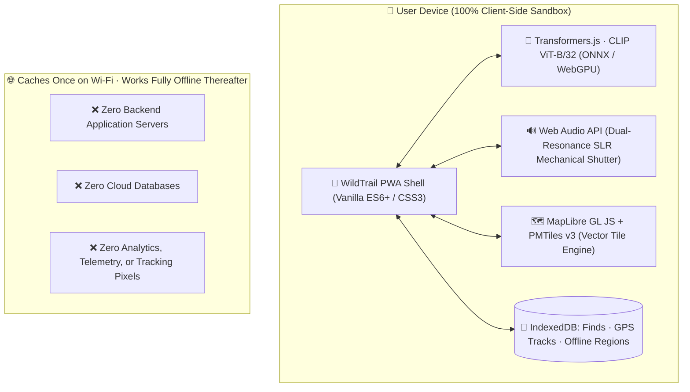
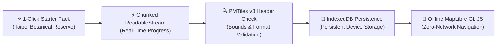

<div align="center">

# 🌿 WildTrail

### Step outside. Discover more. Keep every wild encounter.

**A privacy-first nature exploration PWA with on-device open AI and offline vector maps.**

[](https://wildtrail-chi.vercel.app)
[](https://dev.to/events/challenges/hacktoberfest-week1-2026-10-05)
[](LICENSE)
[](#-install-as-a-progressive-web-app)

<br />

> 🌾 **Built for the Hacktoberfest Open-Source AI Challenge: Week 1 ("Touch Grass")**  
> *Getting people off the screen and into the real world with open-weight computer vision, client-side vector cartography, and zero cloud tracking.*

*Your pocket-sized field station — built for curious minds, muddy trails, and the little things worth noticing.*

</div>

---

## 🌿 The Mission: The Wild is Closer Than You Think

Most modern applications are engineered to keep you staring down at glass screens. **WildTrail does the exact opposite:** it turns your walk through a neighborhood park, forest reserve, or mountain trail into an immersive botanical expedition.

Identify wildlife in real time using open neural models running directly inside your browser. Mint vintage, tactile 3D specimen stamps for every creature or wildflower you encounter. Watch the RPG-style fog-of-war lift as you physically hike outdoors. And navigate remote wilderness with zero cellular coverage using genuine, local PMTiles vector maps.


<div align="center">

| 📷 **Discover** | 📚 **Collect** | 🗺️ **Explore** |
|:---:|:---:|:---:|
| Identify flora and fauna on-device with open neural vision models. | Transform encounters into tactile, scalloped 3D specimen stamps. | Track your trail and uncover map territory cell-by-cell as you hike. |

</div>

---

## 📸 Visual Walkthrough

### 01 · On-Device Species Scanner
Point your camera at any bird, flower, insect, or animal. The vision pipeline runs directly inside your device's browser runtime using WebGPU and WebAssembly. No photos are ever uploaded to cloud servers.

<div align="center">
  
  <p><sub>Instant species suggestions with confidence scoring, hardware lens switching, exact 1:1 framing parity, and a mechanical 35mm SLR shutter sound.</sub></p>
</div>

---

### 02 · Collectible Field Guide & 3D Stamps
Every confirmed observation is minted into a vintage postage stamp. Browse your personal herbarium across kingdoms (Animals, Birds, Plants, Insects), arrange finds by recency or name, and tilt cards to inspect scalloped edges and handwritten field notes.

<div align="center">
  
  <p><sub>Interactive specimen archive featuring multi-axis 3D tilt physics, card flips, and explorer XP progression.</sub></p>
</div>

#### 🏷️ Specimen Stamp Gallery Sample

<div align="center">
  <table>
    <tr>
      <td align="center" width="25%">
        
        <br />
        <b>🐅 Animals</b>
        <br />
        <sub><i>Panthera tigris</i> · 65 XP</sub>
      </td>
      <td align="center" width="25%">
        
        <br />
        <b>🐧 Birds</b>
        <br />
        <sub><i>Alca torda</i> · 55 XP</sub>
      </td>
      <td align="center" width="25%">
        
        <br />
        <b>❄️ Polar Fauna</b>
        <br />
        <sub><i>Spheniscidae</i> · 50 XP</sub>
      </td>
      <td align="center" width="25%">
        
        <br />
        <b>🌸 Plants</b>
        <br />
        <sub><i>Euphorbia milii</i> · 30 XP</sub>
      </td>
    </tr>
  </table>
</div>

---

### 03 · Territory Fog-of-War & Offline Maps
Experience your neighborhood or backcountry trails like an RPG world map. Fog-of-war tiles conceal unexplored terrain until you physically hike through them in 20-meter cells. GPS pathfinding paints glowing trail breadcrumbs, calculates total distance walked, and places interactive discovery pins.

<div align="center">
  
  <p><sub>Dynamic fog-of-war, Google Maps-style dynamic flashlight vision cone, multi-touch rotation, and offline vector cartography.</sub></p>
</div>

---

### 04 · Vintage Herbarium Postcard Export
Export your wildlife discoveries as archival botanical collector postcards. Generated entirely on-device using HTML5 Canvas, each postcard combines high-resolution photography, scientific binomial taxonomy, discovery GPS coordinates, and vintage postmark cancellation stamps ready to share with friends.

---

## 🔒 Zero-Telemetry Local Architecture

WildTrail is engineered around an uncompromising **zero-telemetry, client-side only** architecture:



> [!NOTE]  
> **Privacy Guarantees:**  
> - **100% On-Device Inference:** After initial first-load caching, all AI vision, GPS tracking, and specimen operations run entirely on your device.
> - **Zero Accounts or Logins:** Start exploring immediately without entering an email, password, or third-party OAuth provider.
> - **Private Coordinates:** Your location is processed solely within local browser memory to unmask fog-of-war cells.
> - **Total Data Ownership:** Export your entire journal and trail history as a single JSON file, or wipe local storage with one click.

---

## 🗺️ Complete Offline Vector Maps System

For deep backcountry expeditions without cell signal, WildTrail provides an end-to-end offline cartography pipeline:



- **Default Online Basemap (OpenFreeMap):** Powered by MapLibre GL JS and OpenFreeMap Liberty style (`https://tiles.openfreemap.org/styles/liberty`), highlighting forests, nature reserves, green spaces, waterways, and walking trails with zero API keys or commercial dependencies.
- **1-Click Wilderness Pack Downloader:** Download self-contained wilderness maps (like *Taipei Botanical Reserve*, 6.7 MB) directly inside the app with real-time streaming progress bars (`ReadableStream`), zero manual hunting for files, and automatic IndexedDB persistence.
- **Dynamic Flashlight Vision Cone:** Google Maps-style field of view beam that rotates smoothly in real-time with device compass orientation and GPS movement.
- **Two-Finger Touch Rotation:** Rotate map orientation freely with multi-touch gestures, with an interactive HUD button to snap North-up.
- **Custom URL Downloader & Archive Inspector:** Download any public, CORS-enabled `.pmtiles` archive by direct URL, or inspect geographic bounding boxes, zoom levels ($z0–z21$), and vector layer schemas.
- **Offline Storage Management:** Live storage quota meter calculates exact MB usage and available disk space (`navigator.storage.estimate`).

---

## 🏗️ Technology Stack

| Layer | Technology | Purpose |
|:---|:---|:---|
| **Interface** | HTML5, CSS Variables, Vanilla ES6+ | Zero bundler bloat, instant startup, responsive mobile design |
| **Vision AI** | [Transformers.js](https://huggingface.co/docs/transformers.js) · CLIP `clip-vit-base-patch32` | 100% on-device neural image classification via WebGPU/Wasm |
| **Online Basemap** | [MapLibre GL JS](https://maplibre.org/) · [OpenFreeMap](https://openfreemap.org/) | GPU-accelerated vector street/topo map with zero API keys |
| **Offline Mapping** | [PMTiles](https://protomaps.com/) · Protomaps | Local `.pmtiles` archives persisted in IndexedDB for backcountry use |
| **Local Persistence** | IndexedDB (`finds`, `track`, `regions`, `meta`) | Structured private storage that survives reloads and restarts |
| **Audio Engine** | Web Audio API + HTML5 Audio | Dual PCM synthesis for vintage SLR mechanical shutter sound |
| **PWA & Cache** | Service Worker (`wildtrail-v48`) · Web App Manifest | Full offline shell caching and standalone home-screen experience |
| **Deployment** | [Vercel](https://vercel.com/) | Edge hosting with zero server maintenance |

---

## 🚀 Quick Start & Installation

### Try the Live Web App
👉 **[Open WildTrail → https://wildtrail-chi.vercel.app](https://wildtrail-chi.vercel.app)**

For the optimal outdoor experience, open the link in your mobile browser and install it to your home screen.

---

### Install as a Progressive Web App (PWA)
* **iPhone / iPad:** Open the site in Safari → tap **Share** (box with arrow) → tap **"Add to Home Screen"**.
* **Android:** Open the site in Chrome → tap **Menu (⋮)** → tap **"Install app"** or **"Add to Home screen"**.
* **Desktop:** Click the install icon in the URL bar (Chrome / Edge / Brave).

> [!TIP]  
> **Backcountry Preparation:** Open WildTrail once while connected to Wi-Fi to cache the application shell, vector map engine, and AI model weights (~90 MB). Once cached, the entire application functions without an internet connection in the wilderness.

---

### Run Locally

Camera and geolocation APIs require a secure origin (`HTTPS` or `localhost`):

```bash
# 1. Clone the repository
git clone https://github.com/XiaoArnav/wildtrail.git
cd wildtrail

# 2. Start a local static server
python3 -m http.server 8000
```

Open **`http://localhost:8000`** in your browser.

---

## 🗺️ Roadmap & Milestones

- [x] On-device species identification with OpenAI CLIP (`clip-vit-base-patch32`).
- [x] Vintage perforated 3D specimen stamps with physics tilt and card flips.
- [x] GPS pathfinding with dynamic 20m fog-of-war unmasking.
- [x] Replace CARTO API basemap with OpenFreeMap Liberty (zero API keys).
- [x] Google Maps-style dynamic compass with rotating flashlight vision cone.
- [x] Full offline vector & raster mapping powered by local `.pmtiles` archives.
- [x] 1-Click in-app Wilderness Map Pack downloader with streaming progress.
- [x] Vintage herbarium collector postcard export with postmark stamps.
- [x] IndexedDB storage quota management and archive inspector.
- [x] [**#1 — GPX 1.1 trail track export alongside JSON format**](https://github.com/XiaoArnav/wildtrail/issues/1) *(Implemented via GitHub Copilot PR #7)*
- [ ] [**#2 — Expand offline species taxonomy catalogue for butterflies & wildflowers**](https://github.com/XiaoArnav/wildtrail/issues/2) *(Good first issue · Open for contributors)*
- [x] [**#3 — High-contrast mode for outdoor sunlight readability**](https://github.com/XiaoArnav/wildtrail/issues/3) *(Implemented via GitHub Copilot PR #6)*
- [ ] Audio bird call identification using on-device acoustic models.

---

## 🤝 Contributing & Hacktoberfest 2026

Contributions, bug reports, and ideas are warmly welcomed! WildTrail is an active open-source project participating in **Hacktoberfest 2026**.

1. Fork the repository.
2. Create a feature branch: `git checkout -b feat/your-improvement`
3. Test your changes thoroughly across desktop and mobile browsers.
4. Submit a clear pull request with descriptions and UI screenshots.

> **Hacktoberfest Quality Standards:** In alignment with official Hacktoberfest rules, contributions must add genuine value (e.g. bug fixes, new species classifications, accessibility improvements, or offline optimizations). Automated copy-paste PRs or trivial whitespace edits will not be accepted.

---

## 📜 Credits & Open Source Attribution

WildTrail is made possible by open-source libraries and open geographic data:

* [Transformers.js](https://huggingface.co/docs/transformers.js) by Xenova / Hugging Face
* [MapLibre GL JS](https://maplibre.org/)
* [OpenFreeMap](https://openfreemap.org/)
* [PMTiles](https://github.com/protomaps/PMTiles) by Protomaps
* Map vector data © [OpenStreetMap contributors](https://www.openstreetmap.org/copyright)

---

## ⚖️ License

Distributed under the [MIT License](LICENSE). © 2026 Arnav Patel.

<div align="center">

**Made for the curious. Inspired by the wild.** 🌱

[Explore WildTrail](https://wildtrail-chi.vercel.app) · [View Source Code](https://github.com/XiaoArnav/wildtrail)

</div>
